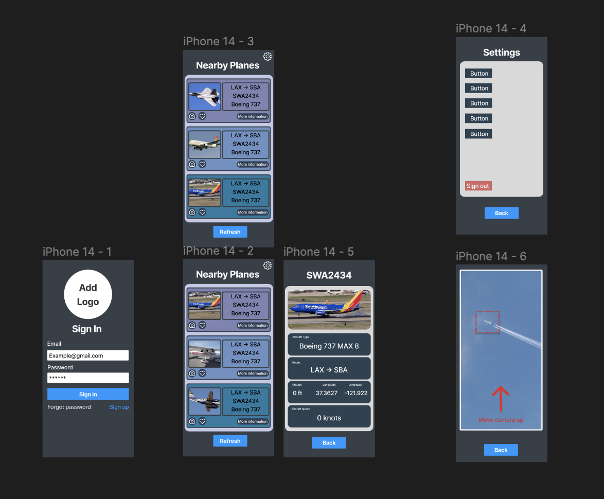
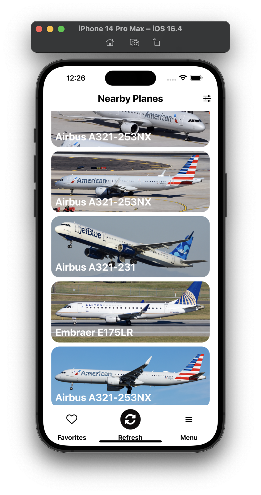

# AirNet

Welcome to AirNet, the flight tracking app that helps people gather flight information nearby. Our mission is to connect the sky by providing the most accurate and up-to-date information on flight schedules and status to our users.

## About Our Team

### Our Founders

AirNet was founded in 2023 by Gen Tamada, Ray Du, Tommy So, and Bryce Wang. Since then, we've been working hard to create a seamless and user-friendly experience for our users. Our team is made up of passionate individuals who are dedicated to providing you with the best possible experience. Thank you for choosing AirNet and we hope you enjoy using our app.

## Features

- **Live Flight Tracking**: Track up to 30 planes in your area in real-time
- **Detailed Information**: View plane location, speed, altitude, and aircraft type
- **AR Plane Tracker**: Point your camera at the sky to locate planes with augmented reality
- **User Accounts**: Sign in to save and manage your favorite planes
- **Advanced Filters**: Sort and filter planes by distance, speed, and other criteria
- **Pull to Refresh**: Get the latest flight data with a simple gesture

## Installation

### Prerequisites
- Node.js and npm installed
- Expo CLI installed globally (`npm install -g expo-cli`)
- iOS Simulator (for Mac) or Android Emulator, or the Expo Go app on your device

### Setup Instructions

1. Clone this repository:
```bash
git clone https://github.com/Ononymous/AirNet.git
cd AirNet
```

2. Install dependencies:
```bash
npm install
```

3. Configure Supabase credentials in `app.json`:
```json
"extra": {
  "supabaseUrl": "YOUR_SUPABASE_URL",
  "supabaseAnonKey": "YOUR_SUPABASE_ANON_KEY"
}
```

4. Start the development server:
```bash
npm start
```

5. Run on your preferred platform:
```bash
npm run ios      # iOS Simulator
npm run android  # Android Emulator
npm run web      # Web Browser
```

## Project Structure

```
AirNet/
├── App.js                 # Main entry point with navigation setup
├── app.json              # Expo configuration and permissions
├── package.json          # Dependencies and scripts
├── assets/               # Images, icons, and theme
├── src/
│   ├── backend/          # Business logic, hooks, and API calls
│   │   ├── Auth.js
│   │   ├── useLocation.js
│   │   ├── useOrientation.js
│   │   ├── usePlaneData.js
│   │   └── supabase.js
│   ├── components/       # Reusable UI components
│   │   ├── BackButton.js
│   │   ├── HeartButton.js
│   │   ├── PlaneItem.js
│   │   └── SearchBar.js
│   ├── tabs/             # Main screen components
│   │   ├── PlaneList.js
│   │   ├── MoreInfo.js
│   │   ├── MyFavorite.js
│   │   ├── Tracker.js
│   │   ├── Setting.js
│   │   ├── About.js
│   │   └── OrientationCalibration.js
│   ├── constants/        # App-wide constants
│   └── utils/            # Utility functions
└── legacy/               # Original codebase and documentation
```

## Technologies Used

- **Expo SDK 54** - Development framework
- **React Native 0.76+** - Mobile app framework
- **React Navigation 6.x** - Navigation and routing
- **Supabase** - Backend authentication and database
- **Axios** - HTTP client for API requests
- **Expo Location** - GPS and heading data
- **Expo Camera** - Camera access for AR
- **Expo Sensors** - Device motion and orientation
- **Math.js** - Mathematical calculations
- **ECEF Projector** - Coordinate system transformations

## Key Features Explained

### AR Plane Tracking
The Tracker uses your phone's camera and sensors to overlay plane positions in augmented reality:
- GPS location determines your position
- Device orientation sensors track where you're pointing
- ENU (East-North-Up) coordinate transformation converts plane positions to local coordinates
- Real-time updates every 5 seconds ensure accurate tracking

### Orientation Calibration
Access the calibration tool from Settings to verify AR tracking accuracy:
- Real-time display of device orientation (alpha, beta, gamma)
- GPS heading information
- Interactive test checklist for different phone positions
- Gimbal lock detection and warnings

### Flight Data
Live flight data is fetched from aviation APIs and includes:
- Aircraft registration and flight number
- Current altitude, speed, and heading
- Aircraft type and airline information
- Distance from your location
- Real-time position updates

## Permissions

The app requires the following permissions:
- **Camera**: For AR plane tracking feature
- **Location**: To display nearby planes and calculate distances
- **Motion Sensors**: For device orientation in AR mode

All permissions are requested at runtime when needed.

## Development Journey

We started by designing the app in [Figma](https://www.figma.com/file/YMjlqVdLgLOY0CEvBPn5Dx/AirNet?t=KbLNHAjL61YLaZ0a-1), creating a comprehensive design system before implementation.

Initial design:


Final implementation:


[Mid-point Presentation](https://docs.google.com/presentation/d/13k8u5GwKJcpTi3HXs5ICFjLOTZJt4VP88dQwsHjMpXA/edit?usp=sharing)

[Final Showcase Presentation](https://www.canva.com/design/DAFhz1USANU/KwKERXrIxxzKBm-GShMLpQ/view?utm_content=DAFhz1USANU&utm_campaign=designshare&utm_medium=link&utm_source=publishsharelink)

## Security

- Supabase credentials are stored in `app.json` and accessed via `Constants.expoConfig.extra`
- Never commit actual credentials to version control
- All API calls include proper error handling
- User authentication handled securely through Supabase

## Documentation

Additional technical documentation can be found in the `legacy/` folder:
- `DOCUMENTATION.md` - Complete technical analysis and architecture
- `CODE_IMPROVEMENTS.md` - Implementation recommendations
- `AR_TRACKING_MATH.md` - Detailed explanation of AR coordinate transformations
- `ROADMAP.md` - Future development plans

## Contributing

If you have questions or feedback, please don't hesitate to contact us. We welcome contributions and suggestions to improve AirNet.

## Credits

### Developers

#### Backend
- [Gen Tamada](https://github.com/Ononymous)

#### Frontend
- [Ray Du](https://github.com/CongruiDu)
- [Tommy So](https://github.com/Tommygithubaccount123)
- [Bryce Wang](https://github.com/brycewangg)

#### Special Thanks
- Jiajia Feng

---

*AirNet - Connecting the sky, one flight at a time.*

All permissions are properly configured in `app.json` with user-friendly descriptions.
